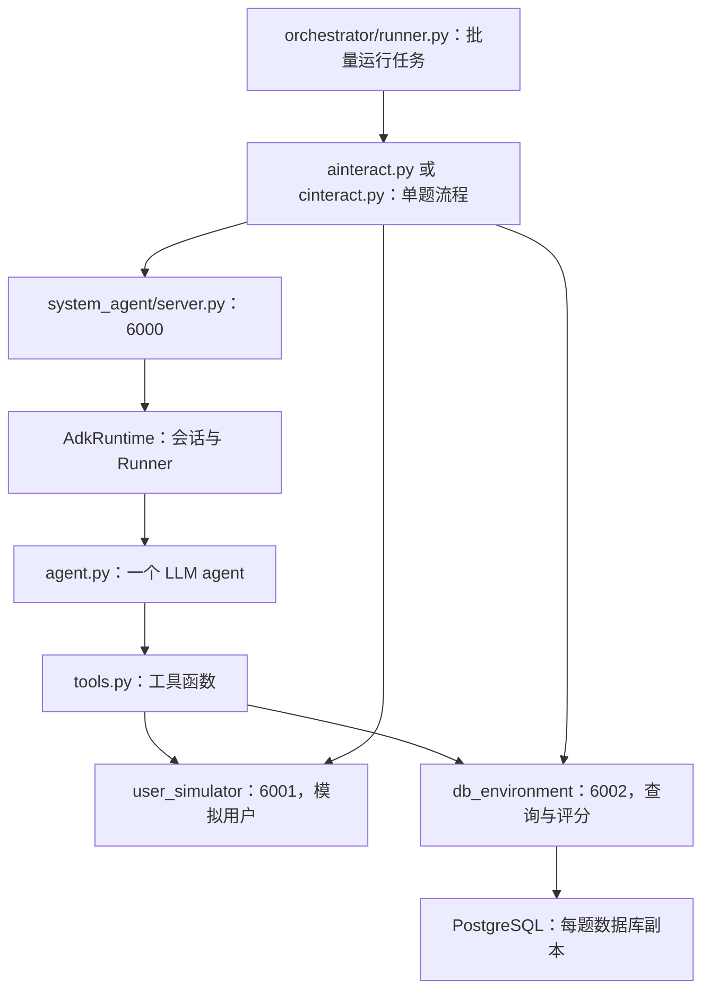

# BIRD-Interact 的 agent 框架：从代码理解默认实现与修改边界

本文面向第一次接触 agent 框架的读者，目标是让你能回答：默认 agent 如何完成一道题？决策、记忆、工具、控制流程各在哪里？提出一种改进后，该改哪个文件？ADK 究竟封装了什么？

**本项目的默认 system agent，是一个由 LLM 决定下一步行动、由 ADK 执行工具调用循环的单 agent。项目自己提供提示词、工具函数、预算规则和测评流程。** 它没有显式配置规划器、SQL 审核员、多 agent 协作、候选 SQL 搜索或结构化意图记忆。

本文基于 2026-10-22 阅读到的当前工作区代码，包含已有本地修改，不把它等同于最初发布版本或论文参考实现。ADK 底层核对使用本机 `bird-interact` conda 环境的 `google-adk==2.9.2`；仓库 [requirements.txt](../requirements.txt) 只要求 `google-adk>=1.0.0`，因此别的环境可能不同。以下运行过程来自代码阅读，没有重新执行付费测评。

阅读入口：[根 README](../README.md)、[本地研究记录](../agent/README.md)、[协议恢复记录](../agent/REFERENCE_PROTOCOL_RESTORE_2026-10-13.md)。历史记录包含多次实验演变，当前行为以代码和该次运行配置为准。

## 1. “agent 框架”指什么

普通的一次 LLM 调用可以写成：

```python
answer = call_llm(question)
```

在这里，一道题可能需要先看数据库结构，查某个业务指标的定义，向用户确认时间范围，再试 SQL、提交 SQL、根据错误修改。于是程序要支持反复执行：

```text
把当前信息交给模型
→ 模型选择行动，例如 get_schema 或 ask_user
→ 程序执行行动
→ 把结果交回模型
→ 模型选择下一步行动
→ ……直到提交完成，或运行停止
```

包围模型、让这件事发生的程序结构，通常叫 agent scaffold，也可以称“agent 框架”。这里的“框架”有两个层次：

| 名称 | 在本项目中的含义 |
| --- | --- |
| 基础模型 | 实际生成文字、工具名称、工具参数和 SQL 的 LLM |
| agent scaffold | 给模型什么信息、允许它用什么工具、如何记录状态、如何组织步骤和停止 |
| ADK | 通用的开发库，为 scaffold 提供 Agent、Runner、工具封装、会话和回调机制 |
| BIRD-Interact 测评框架 | 提供任务、模拟用户、数据库、评分、预算与阶段协议，以及批量运行程序 |

你要研究的“改 agent 框架提高表现”，通常指修改 scaffold。例如：让模型显式记录已确认条件，生成 SQL 后由另一个角色检查条件覆盖，或者规定先制定计划再执行。换模型是另一个实验变量；改评分规则则改变了测评环境。

可以把一个 scaffold 拆成六部分：

| 部分 | 回答的问题 | 本仓库入口 |
| --- | --- | --- |
| 模型与调用参数 | 谁来思考？每次输出多长？ | [shared/llm.py](../shared/llm.py)、[shared/config.py](../shared/config.py) |
| 提示词与上下文 | 模型知道什么、被要求做什么？ | [system_agent/agent.py](../system_agent/agent.py) |
| 工具 | 能采取哪些行动？ | [system_agent/tools.py](../system_agent/tools.py) |
| 状态与记忆 | 剩余预算、已确认条件、历史存在哪里？ | 两个 orchestrator 的 session 初始化，以及 ADK session |
| 控制流程 | 何时调用模型、工具、进入下一阶段？ | ADK 循环、[adk_runtime.py](../system_agent/adk_runtime.py)、两个 orchestrator |
| 约束与反馈 | 什么行动被阻止？什么时候停止？ | 两套 callbacks、工具返回值、数据库评测服务 |

## 2. 先分清：谁是答题者，谁是环境



- **System agent 是被测的答题者。** 它根据公开问题和交互反馈产生 SQL，你主要改这一层。
- **User simulator 是环境中的用户。** `ask_user` 并不会把问题发给真实的人，而是请求 `user_simulator/server.py`。该服务用隐藏意图、歧义标注、参考 SQL 等信息生成回答。
- **DB environment 是数据库接口和裁判。** 它提供 schema、知识、查询结果，并用参考 SQL / 测试用例判定提交。
- **Orchestrator 是测评组织者。** 它读取任务、初始化各服务、控制阶段、收集成绩。

虽然 simulator 也会调用 LLM，但它不是答题 agent 的合作伙伴。默认 system agent 内部也没有“两位 agent 分工”。

信息边界尤其要看 [ainteract.py](../orchestrator/ainteract.py) 的 `init_task_on_services()` 和 `init_agent_session()`：完整 `task_data` 发给数据库和模拟用户；给 system agent 的 state 则只挑选任务 ID、数据库名、模糊问题、预算等字段。c-interact 另外提供 schema 和外部知识。**完整任务对象在 Python 程序中可访问，不代表其中的 `sol_sql`、测试用例和隐藏标注可以放进答题上下文。**

## 3. 默认 agent 是怎样组装出来的

### 3.1 `build_agent()` 是最直接的入口

[system_agent/agent.py](../system_agent/agent.py) 中，a-interact 的主体如下，省略了名称和描述：

```python
return Agent(
    model=model,
    instruction=AINTERACT_INSTRUCTION,
    tools=get_ainteract_tools(),
    before_model_callback=before_model_callback,
    before_tool_callback=before_tool_callback,
    after_tool_callback=after_tool_callback,
    generate_content_config=types.GenerateContentConfig(temperature=0.0),
)
```

这里用的是 `google.adk.Agent`，在本机 ADK 中对应 `LlmAgent`。它意味着“让 LLM 决定如何使用工具”，而不是代码里提前写死每一步。

这段配置决定：

1. 用哪个模型。
2. 用什么任务提示词。
3. 模型可以调用哪些工具。
4. 每次模型调用前、工具调用前后，执行哪些自定义函数。
5. 生成参数，例如这里的 temperature 为 0。

c-interact 也创建一个 `Agent`，但换成 `CINTERACT_INSTRUCTION`、另一套 callbacks，并只注册 `ask_user` 和 `submit_sql` 两个工具。

**给同一个模型换工具、提示词、记忆和流程，就已经是在改 scaffold。** 不要求先换一个开发库。

### 3.2 提示词里的“策略”是建议，不是执行计划

`AINTERACT_INSTRUCTION` 建议先查 schema、列含义、知识，必要时澄清、测试、提交。代码没有强制“第一步必须 get_schema”。模型可以重复查知识，也可以信息不足时直接提交。

所以默认结构可以理解成“行动—观察—再决策”的工具循环。它类似常见的 ReAct 思路，但代码没有要求固定的 `Thought/Action/Observation` 文本格式，也没有单独实现一个 ReAct 解析器。

若你希望“必须经过 SQL 检查才允许提交”，仅在 prompt 中写一句话是软约束；在提交前的回调中检查状态，才是程序约束。两种修改都有效，但保证程度不同。

### 3.3 实际模型调用还经过适配层

调用关系是：

```text
build_agent()
→ shared.llm.build_adk_model(settings.system_agent_model)
→ google.adk.models.lite_llm.LiteLlm
→ 模型服务
```

[shared/llm.py](../shared/llm.py) 的默认 `build_adk_model()` 设置 `max_tokens=4096`、`num_retries=5`；还含特定供应商参数。例如当前 DeepSeek 分支明确关闭 thinking，Kimi K3 分支设定 `reasoning_effort="low"`。

因此，研究“开启推理模式”需要同时检查模型适配层，不能只改 agent prompt。修改普通 `call_llm()` 也不一定改变 system agent：ADK 的主调用路径使用的是 `build_adk_model()`。文件还支持可选的 `shared/_local_provider.py` 覆盖；本次检查未发现该文件。

模型配置优先级见 [shared/config.py](../shared/config.py)：环境变量 > `.env` > 代码默认值。源码当前默认 system model 为 `deepseek/deepseek-flash`，但不能据此推断某次已启动服务的实际模型；运行配置和 `/health` 更可靠。

## 4. 追踪一次 a-interact：从问题到 SQL

### 4.1 外层只发起一次任务运行，内层可以调用模型很多次

[orchestrator/runner.py](../orchestrator/runner.py) 负责并发调度，实际单题函数在 [ainteract.py](../orchestrator/ainteract.py) 的 `run_single_task()`。

顺序是：

1. 初始化数据库副本与 simulator。
2. 根据歧义数量和 patience 计算初始预算。
3. 调用 system-agent 的 `/init_session`，创建本题 session。
4. 把数据库名、任务 ID、用户问题和预算发送给 `/run_session`。
5. 等待内部 agent 循环结束，从返回的 `state` 读取成绩与轨迹。
6. 在 `finally` 中清理数据库任务资源。

不要把“一次 `/run_session`”理解成“一次 LLM 请求”。这一次 HTTP 请求可以包含几十次模型决策、多个工具调用，甚至从 Phase 1 做到 Phase 2。

### 4.2 仓库没有手写完整的工具循环，因为循环在 ADK 中

[adk_runtime.py](../system_agent/adk_runtime.py) 的 `run_turn()` 关键代码是：

```python
async for event in runner.run_async(
    user_id=ref.user_id,
    session_id=ref.session_id,
    new_message=new_message,
):
    turn_events.append(self._serialize_event(event))
```

这是对 ADK 事件流的消费。实际“调用模型 → 执行工具 → 再调用模型”发生在 ADK 内部。下面是帮助理解的简化过程，不是仓库原样代码：

```python
while 本次运行尚未结束:
    request = 组织提示词_历史_工具声明()
    response = before_model_callback(context, request)
    if response is None:
        response = 调用LLM(request)

    if response包含工具调用:
        for call in 工具调用集合:
            result = before_tool_callback(call)
            if result is None:
                result = 执行工具(call)
            result = after_tool_callback(call, result)或原结果
            将工具结果写入会话事件
    else:
        产生最终回复并结束本次运行
```

实际 ADK 支持一次响应中的多个工具调用，调度与异常分支比这个示意复杂；不要依赖示意中的 `for` 推断所有工具都严格串行。

### 4.3 模型“调用工具”是什么

以查询 schema 为例，模型发出的结构化动作大致是：

```json
{"name": "get_schema", "args": {}}
```

ADK 找到注册的 `FunctionTool(get_schema)`，运行 [tools.py](../system_agent/tools.py) 中的 Python 函数。函数从 `tool_context.state` 取得 `task_id`，向数据库服务的 `/schema` 发送 HTTP 请求，把响应作为工具结果返回给模型。

模型通常看到函数名、描述和参数 schema，而不是 Python 函数体。`FunctionTool` 利用函数签名、类型注解和 docstring 生成工具声明。因此，**修改工具 docstring 也会影响模型如何使用工具。**

`ToolContext` 是 ADK 注入的运行上下文，不是让模型填写的工具参数。模型调用 `execute_sql` 主要提供 `sql`；任务 ID 和预算由程序管理。

### 4.4 九个工具分别干什么

注册入口：`get_ainteract_tools()`；费用表：`callbacks.py` 的 `TOOL_COSTS`。

| 工具 | 信息/动作 | a-interact 单次费用 |
| --- | --- | ---: |
| `get_schema` | 获取数据库 schema | 1 |
| `get_all_column_meanings` | 获取所有列说明 | 1 |
| `get_column_meaning` | 获取指定表、列的说明 | 0.5 |
| `get_all_external_knowledge_names` | 获取知识条目名称 | 0.5 |
| `get_knowledge_definition` | 获取指定知识定义 | 0.5 |
| `get_all_knowledge_definitions` | 获取全部知识定义 | 1 |
| `execute_sql` | 执行探索/验证查询，返回结果或执行错误 | 1 |
| `ask_user` | 请求模拟用户回答澄清问题 | 2 |
| `submit_sql` | 正式提交给 evaluator | 3 |

`execute_sql` 成功只说明该查询能执行，不代表回答符合用户真实意图。只有 `submit_sql` 才经过评分流程。

数据库 `/execute` 当前用去注释后的 SQL 前缀检查，接受 `SELECT`、`WITH`、`EXPLAIN`，意图限制为查询探索；这是具体实现，不是完整 SQL 语义安全证明。正式提交另走 `/submit`，支持测评中的查询及其他类别任务。

### 4.5 预算由本项目回调管理

初始预算在 `ainteract.calculate_initial_budget()`：

```python
budget = 6 + 2 * (关键问题歧义数 + 知识歧义数) + 2 * settings.patience
```

[callbacks.py](../system_agent/callbacks.py) 实现三件事：

| 回调 | 触发时机 | 当前行为 |
| --- | --- | --- |
| `before_model_callback` | 即将调用模型 | 累计 `model_turns`；超过 60、任务完成或预算为负时返回固定回复，结束循环 |
| `before_tool_callback` | 即将执行工具 | 按工具扣费；余额不够时阻止普通工具，提示提交 |
| `after_tool_callback` | 工具执行后 | 记录工具轨迹，在返回结果后附上剩余预算 |

注意预算耗尽的具体语义：

- 余额不足以支付 `submit_sql` 时，仍允许一次免付费的最终提交，并置 `budget_remaining=-1`。
- 正常提交恰好把余额用到 0，也置为 `-1`，让下一次模型前检查停止。
- 普通工具把余额用到 0，并不直接结束运行；模型仍有机会选择最终提交。
- 普通工具先扣费再执行，因此服务失败也不自动退款。

60 是项目回调的模型轮次上限，不是“最多调用 60 个工具”，也不是模型 API 的重试次数。这个计数还包括被回调提前结束、没有真正调用模型的检查，所以不能直接当成真实 API 次数。

### 4.6 Phase 2 如何开始，成绩从哪里来

`submit_sql()` 向数据库 `/submit` 发请求。数据库服务 `_submit_sql_sync()` 才执行评分和数据库阶段转换，工具函数把评测结果同步进 session：

```python
if phase == 1:
    tool_context.state["phase1_completed"] = True
    tool_context.state["current_phase"] = 2
elif phase == 2:
    tool_context.state["phase2_completed"] = True
    tool_context.state["task_done"] = True
```

原函数还会累计 reward；P1 没有后续任务时直接设 `task_done=True`；有后续任务则通知 simulator 切换阶段，并把 follow-up 问题附在工具响应中。

a-interact 的模型读取这个工具响应后，继续同一次运行完成 P2，预算也继续使用原来的余额。数据库会保存成功 P1 的状态快照，P2 提交从该状态评测，不一定是从最初数据库状态评测。

**模型最后输出“完成了”并不等于得分。** orchestrator 读取的是 `phase1_completed`、`phase2_completed`、`total_reward` 等状态，最终来源应是 evaluator 返回的结果。

## 5. c-interact 与 a-interact 到底哪里不同

| 对比项 | a-interact | c-interact |
| --- | --- | --- |
| 默认答题 agent | 一个 LLM agent | 一个 LLM agent |
| 工具 | 九个 | `ask_user`、`submit_sql` |
| 初始 schema / 知识 | 通过工具按需获取并付费 | orchestrator 预取，放入提示词 |
| 主要资源限制 | bird-coins | 澄清次数 `max_turn` |
| P1 失败后的尝试 | 只要循环和预算允许，可继续尝试 | orchestrator 再发一次 debug 消息 |
| P2 推进 | follow-up 在提交结果中返回，内部循环继续 | orchestrator 单独发 follow-up 消息 |
| 一题 `/run_session` 次数 | 通常一次 | 最多四次：P1、P1 debug、P2、P2 debug |
| P1 / P2 首次成功奖励 | 0.7 / 0.3 | 0.7 / 0.3 |
| 后续尝试成功奖励 | 仍为 0.7 / 0.3 | 0.5 / 0.2 |

奖励规则在 [db_environment/server.py](../db_environment/server.py) 的 `_submit_sql_sync()`，不在 ADK。

c-interact 的 [CINTERACT_INSTRUCTION](../system_agent/agent.py) 中有 `{db_schema}`、`{external_kg}`、`{max_turn}`。这些变量由 [cinteract.py](../orchestrator/cinteract.py) 写入 session state，再由 ADK 填入 instruction。这里的 `max_turn = 关键问题歧义数 + 知识歧义数 + patience`。

[callbacks_cinteract.py](../system_agent/callbacks_cinteract.py) 在提交后设置 `_submitted_this_phase=True`。下一次模型调用前看见该标志，就返回固定文本，结束本次运行。`adk_runtime.run_turn()` 在下一次 c-interact 运行前，通过 `EventActions(state_delta=...)` 清除此标志；同一个 session 的历史仍保留。

外层 `cinteract.run_single_task()` 检查提交结果，决定是否发 debug 或 follow-up。因此 **c-interact 是“外层规定阶段 + 内层模型选择工具”的组合**。

### 实现细节不能只按注释理解

以下是阅读当前代码得到的边界，本文未修改这些行为：

1. **澄清次数没有工具前的硬拦截。** c-interact 的 `before_tool_callback()` 直接返回 `None`；`after_tool_callback()` 只是附加剩余次数提示。simulator 的 `/ask` 也没有轮数拒绝逻辑。提示词规定的上限，并没有在这里被严格执行。
2. **一次运行一个提交，是当前停止机制的意图。** `_submitted_this_phase` 在下一次模型调用前检查；如果模型同一次响应发出多个提交工具调用，当前工具前回调没有逐个拒绝。不能把它理解为覆盖所有批量调用情况的严格保证。
3. **`phase_max_turns` 被初始化但当前没有用于限制循环。** 两套 callbacks 实际使用各自的 `MAX_MODEL_TURNS=60`；`model_turns` 不在每次 c-interact 调用前清零，因此按 session 累计。
4. **HTTP 成功结束不代表任务成功。** a-interact 中模型也可能直接给出普通最终文本，让 ADK 结束当前运行，即使预算还够、也尚未提交；外层不会自动补发“请继续”。
5. **`system_agent/server.py` 顶部关于 `/chat` 和 legacy fallback 的注释已过时。** 当前实际路由是 `/init_session`、`/run_session`、`/health`；两种模式都使用 session API。

这些边界影响你对失败轨迹的解释。如果以后修复约束，应记录协议变化，并在修复后的同一环境重新跑 baseline 与新方法。

## 6. 默认“记忆”是什么：state、对话历史和事件不是同一个东西

### 6.1 Session state 是程序的工作区

初始化入口分别是 `ainteract.init_agent_session()` 和 `cinteract.run_single_task()`。运行中通过 `tool_context.state` 或 `callback_context.state` 读写。

| 状态字段 | 用途 |
| --- | --- |
| `task_id`、`db_name` | 定位当前任务和数据库 |
| `budget_remaining`、`initial_budget` | a-interact 预算 |
| `max_turn` | c-interact 澄清次数提示 |
| `model_turns` | 项目回调的轮次计数 |
| `phase1_completed`、`phase2_completed`、`task_done` | 任务进度与停止信号 |
| `total_reward` | 累计 evaluator 奖励 |
| `_last_submit_raw` | 原始提交消息，供 c-interact 区分执行错误与答案错误 |
| `_submitted_this_phase` | c-interact 本次运行已提交标志 |
| `dialogue_history`、`tool_trajectory`、`adk_events` | 项目保存的交互和观测记录 |

**把某个字段放入 state，不代表模型自动看得见。** 例如添加 `intent_memory` 后，仍需用 instruction 占位符、模型前回调或工具输出把它送入模型上下文。

当前预算通过初始消息、工具后的系统提示等途径传给模型；c-interact 的 schema 则通过 instruction 占位符传入。

### 6.2 ADK session events 承载正常对话上下文

ADK 记录用户消息、模型输出、function call 和 function response，并据此构造后续请求。默认 agent 没有关闭历史上下文，也没有在本项目里配置专门的历史压缩策略。

`dialogue_history` 只是 `ask_user()` 手动维护的问答列表，主要供结果分析。它没有覆盖所有工具信息，也不是 ADK 的完整模型历史。清空这个列表，不等于清空模型记忆。

同理，state 中的 `adk_events` 是本项目通过 `_serialize_event()` 生成的观测副本，不是 ADK 内部会话事件本身。修改这个列表不会自动重写 ADK 的上下文。

### 6.3 当前记忆能力的实际范围

默认 agent 依赖历史消息记住用户澄清，没有专门的结构化模块区分：已确认条件、尚未证实的假设、候选公式、待问问题、SQL 尚未覆盖的约束。

`AdkRuntime` 为每个 mode 缓存 Runner，按 `(mode, task_id)` 保存 session 引用；采用内存 session service。项目没有配置跨进程的持久会话恢复，也没有配置向量记忆库。结果 JSON 能用于诊断，不等于能从其中直接恢复任意中间步骤。

观测还有两个限制：

- `tool_trajectory` 的结果预览截到 2000 字符；runtime 的事件文本/响应预览通常截到 4000 字符。**这是日志截断，不能据此认为模型只看到了这么多字符。**
- c-interact 每次拿到累计 `state["adk_events"]` 后又 `extend` 到汇总列表，可能重复记录早先事件。直接用最终 JSON 的事件条数统计模型调用数会失真。

## 7. ADK 封装了什么，哪些仍然可以改

“ADK 封装了，所以我们不能修改”需要拆成三个层次：**通过公开接口配置；替换实现；直接修改第三方库源码。** 前两种通常已经足够实现研究想法。

ADK 的公开接口允许设置模型、instruction、工具和回调。回调可以修改模型请求，也可以提前返回结果、跳过默认调用。参见官方 [LLM agents](https://adk.dev/agents/llm-agents/) 与 [callback 类型](https://adk.dev/callbacks/types-of-callbacks/)；具体细节以实验安装版本为准。

| 功能 | 当前由谁实现 | 你如何改变它 |
| --- | --- | --- |
| 提示词和工具选择范围 | 本项目 `agent.py` | 直接改配置或新建 agent 构造器 |
| 工具 HTTP 调用、返回格式 | 本项目 `tools.py` | 直接改工具函数；保留环境操作和计费语义 |
| 预算、轮次、停止规则 | 本项目 callbacks / orchestrator | 技术上能改；要区分策略调整与协议调整 |
| 状态字段与结构化记忆 | 本项目决定字段，ADK 承载 state | 添加字段和更新逻辑，并明确传入模型 |
| prompt 占位符替换、常规历史组织 | ADK | 用 instruction / 模型前回调等接口定制；更深改动可换上下文构造方式 |
| 工具声明生成、参数注入、函数调用分发 | ADK `FunctionTool` 与工具调度 | 改函数签名/docstring，或实现自定义工具封装 |
| “调用模型→工具→再调用模型”的默认循环 | ADK LLM flow | 用回调干预，或改用工作流/自定义 agent，或替换 runtime |
| Session、Event、状态增量机制 | ADK | 使用其接口，替换 session service；底层事件语义不是改业务 prompt 能改变的 |
| 模型请求与工具消息的供应商格式适配 | ADK LiteLlm + LiteLLM | 修改 `shared/llm.py` 的配置；缺少能力时实现适配器 |
| 用户回答、数据库测试、奖励判定 | 本仓库环境服务 | 不属于 ADK；改变它们会改变测评条件 |
| 模型内部权重和推理实现 | 模型服务 | 本仓库不能靠修改 agent 代码改变权重；只能用服务支持的参数或换模型 |

ADK 是可扩展的开源库，不存在绝对的“源码不能改”。但直接改 `site-packages` 会让代码修改脱离仓库版本管理，实验难以复现。若确实必须改内部实现，应固定依赖版本并管理 fork/补丁。

本机核对过的 ADK 源码位置如下；这些路径相对于安装目录 `google/adk/`，不是本仓库文件：

| 路径 | 想深挖时看什么 |
| --- | --- |
| `agents/llm_agent.py` | LlmAgent 配置、历史选项、planner 与回调接口 |
| `runners.py` | Runner 执行入口与会话衔接 |
| `flows/llm_flows/base_llm_flow.py` | 默认模型调用循环和终止判断 |
| `flows/llm_flows/instructions.py` | instruction 与 session state 注入 |
| `flows/llm_flows/functions.py` | 工具调用处理入口，本版本会委托其他模块 |
| `tools/function_tool.py` | Python 函数如何转换成工具、注入 ToolContext |

**你完全可以保持 ADK，改变 agent 架构；也可以替换 system-agent 服务内部实现，保留测评环境。** HTTP 服务边界就是一个可用的替换点。

## 8. 不同类型的改进，具体改哪里

下面的表按实现范围排列。“可以改”表示代码上可实现；涉及环境访问、预算和评分的变动仍需明确实验定义。

| 想做的修改 | 主要位置 | 还要配合什么 |
| --- | --- | --- |
| 改澄清策略、要求逐项检查条件 | `agent.py` 的两段 instruction | 确认改的是所跑 mode 的 prompt |
| 换 system model | `.env` 的 `SYSTEM_AGENT_MODEL` | 检查 `shared/llm.py` 供应商适配；重新启动 agent 服务 |
| 改 temperature、输出长度、推理参数 | `agent.py`、`shared/llm.py` | 区分 system agent 与 simulator；记录额外 token 成本 |
| 改工具描述或压缩工具结果 | `tools.py` 的 docstring / 返回值 | 检查是否丢掉公式、列名或错误详情；不要只改日志 `_preview` |
| 每步提醒还未满足的用户约束 | `callbacks.py` 的模型前回调，或动态 instruction | 需要先维护约束状态 |
| 维护结构化意图记忆 | 新建记忆模块；修改 session 初始化、工具后回调、模型前回调 | state 字段不会自动进入 prompt |
| 生成多个候选 SQL，再内部选择 | `agent.py` 加角色/流程，或自定义 agent/runtime | 每次实际 SQL 执行与提交仍通过统一工具和计费入口 |
| 引入规划者、SQL 生成者、审核者 | `build_agent()` 改成组合架构；必要时改 runtime | 定义共享状态、交接格式、退出条件；所有环境动作共享同一任务预算 |
| 控制模型过早结束、在未提交时继续 | `adk_runtime.py` 或自定义控制流程 | 设置明确终止上限，保留原协议的提交/计费语义 |
| 改会话持久化、恢复、事件日志 | `adk_runtime.py` | 正式 session event/state 更新尽量走 ADK 接口 |
| 改并发、任务抽样、输出位置 | `orchestrator/runner.py` | 这是实验调度，不直接构成答题策略改进 |
| 改 P1/P2 次数、预算公式、费用 | 两个 orchestrator、callbacks、数据库服务 | 属于协议变更，baseline 必须在同条件下重跑 |
| 改模拟用户回复行为 | `user_simulator/server.py`、`prompts.py` | 是 simulator 实验变量，不应与 scaffold 改进混在一起归因 |
| 改 SQL 判分、奖励、数据库重置 | `db_environment/server.py`、`shared/db_utils.py` | 是 evaluator / 环境变更 |

### 新增工具不能只注册名字

a-interact 的 `before_tool_callback()` 对没有出现在 `TOOL_COSTS` 中的工具直接放行。因此新增工具需要检查：注册、工具描述、预算策略、轨迹记录、是否访问环境、是否暴露隐藏信息。

例如 `explore_everything()` 内部如果直接请求五个数据库接口，而外层只扣一次费，就改变了环境交互成本。Python 函数内部直接调用其他工具函数，也不会自动让 ADK 为每个内部调用再执行一遍回调。组合工具需要显式保持底层动作计费。

纯内部的计划整理或 SQL 静态检查，不等同于数据库交互；但如果它额外调用 LLM，应单独计入 token、费用和延迟。bird-coins 不是推理成本总表。

### 多 agent 也必须有统一的任务状态

如果增加 reviewer，不宜让它获得一个独立预算，或者直接访问 evaluator 绕过 `submit_sql`。需要决定哪些角色能调用环境工具、如何共享预算和提交结果、是否保留同一 session，以及角色之间如何传递已确认信息。

本项目没有现成的这套协调逻辑；这正是你要设计的架构部分。ADK 提供组合/自定义 agent 的基础能力，但不会自动替你满足 BIRD-Interact 的协议。

### 完全替换 ADK 的最低接口契约

可在 `system_agent/server.py` 后面换成自己的实现，尽量维持：

- `/init_session` 接收 `task_id`、`mode`、`state`、`reset`。
- `/run_session` 接收 `task_id`、`mode`、`message`，返回 `response` 和 `state`。
- a-interact 的 state 保留阶段完成标志、reward、预算和轨迹字段。
- c-interact 还需要 `_last_submit_raw`，以及支持同一任务多次运行和阶段重试。
- 保持环境服务的真实提交、预算、阶段转换和任务隔离，成绩继续来自 evaluator。

这样可以研究完全自写的循环，而不必同时重写数据库评分器和模拟用户。

## 9. 一个适合作为起点的修改：显式用户意图记忆

假设失败模式是：用户已经确认“只统计 2024 年、按客户去重”，但模型最后生成的 SQL 忘了年份或用了 `COUNT(*)`。

仅加 prompt 的版本是：“生成 SQL 前检查所有已确认条件”。更明确的架构版本则增加一个贯穿交互的状态表示。

下面是**设计示例，尚未实装**：

```python
# 每题初始化；可抽出共享函数供两种 mode 使用
state["intent_memory"] = {
    "confirmed": [],       # 已确认条件及证据来源
    "hypotheses": [],      # 尚未确认的解释
    "open_questions": [],  # 仍待澄清的问题
    "sql_checklist": [],   # 生成 SQL 时需要覆盖的条件
}
```

落地顺序：

1. **定义结构。** 可新增 `system_agent/intent_memory.py`。每个已确认条件记录来源，例如某次用户回复或已取得的知识定义，不把模型猜测直接升级成事实。
2. **初始化。** 在两个 mode 的 session 初始化处加入空结构。这里不传完整任务标注或参考 SQL。
3. **更新。** 在 `ask_user` / 知识检索之后，通过工具后回调或专门更新函数提取信息。当前工具结果不必全是 JSON，解析逻辑需处理文本和失败响应。
4. **展示给模型。** 在 `before_model_callback()` 中向 `llm_request` 追加简明记忆，或者通过动态 instruction / state 占位符注入序列化内容。保留原来的预算和停止检查。
5. **SQL 检查。** 先做只给反馈的版本：要求生成 SQL 时逐项覆盖 checklist。需要硬控制时，再在提交前检查“是否完成审核”，并明确失败后如何恢复，防止永远无法提交。
6. **保存证据。** 在结果中增加可分析的记忆更新记录，才能区分“提取错了”“记对了但生成 SQL 时忽略了”“审核漏了”。

要特别注意第四步。下面只是机制示意，不是可直接替换的完整代码：

```python
async def before_model_callback(callback_context, llm_request):
    # 先保留原有 MAX_MODEL_TURNS / task_done / budget 检查
    ...
    memory = callback_context.state.get("intent_memory", {})
    llm_request.append_instructions([
        "当前已确认的用户要求与待解决问题：\n" + serialize_memory(memory)
    ])
    return None  # 继续实际模型调用
```

如果抽取记忆也调用 LLM，就增加了推理成本。一个清楚的对照是：原 scaffold、仅改 prompt、显式记忆三个版本，保持模型、任务、simulator、预算与 evaluator 相同，并同时报告成绩和成本。这能帮助判断收益来自结构化记忆，还是单纯增加了提示或模型调用。

这个例子主要涉及你自己的代码和 ADK 公开接口，无需修改 ADK 源码。

## 10. 如何阅读轨迹，判断该改哪一层

按以下顺序检查一条失败任务，通常比直接换 prompt 更有帮助：

| 轨迹现象 | 先看哪里 | 候选修改方向 |
| --- | --- | --- |
| 一直重复请求同一知识，余额用尽 | `tool_trajectory` 的参数、返回和预算 | 检索去重、失败策略、预算分配 |
| 用户已澄清但 SQL 漏条件 | `dialogue_history` 与提交 SQL | 意图记忆、条件覆盖检查 |
| SQL 语法或列名错误 | `execute_sql` / `submit_sql` 错误 | 生成前 schema 对齐、执行反馈修复 |
| 还有余额却直接结束且没有提交 | `adk_events`、最终文本、完成标志 | 终止控制、显式任务完成条件 |
| simulator 只回标签或固定 fallback | `ask_user` 返回及 simulator 日志 | 先诊断环境回复质量，不直接归因于 SQL 生成 |
| 分数正常但事件条数异常 | runtime 序列化、c-interact 事件汇总 | 修正观测统计，勿把重复日志当实际行为 |

`tool_trajectory` 也不能一概当成“实际执行并付费的操作清单”：本机 ADK 2.9.2 在工具前回调返回替代结果后，仍会执行工具后回调，因此被预算拦截的调用也可能被记入轨迹。当前记录中的 `cost` 是费用表中的标称值，不一定是实际扣费；`_budget_before` 还可能沿用旧值。统计时应结合错误返回、预算变化与 ADK function call/response 事件，而不是简单累加 `cost`。

另外，[user_simulator/test_server.py](../user_simulator/test_server.py) 包含与原版 Git 基点做一致性比较的测试，涉及 system-agent 文件。今后有意修改 scaffold 时，这类测试可能因为“与原版不一样”而失败，并不自动说明新机制有功能错误。应保留原 baseline 的协议检查，明确区分新方法的功能验证与原版一致性验证。

## 11. 建议的代码阅读顺序

1. [system_agent/agent.py](../system_agent/agent.py)：先看 `build_agent()`，认识六个构造参数，再读两段 instruction。
2. [system_agent/tools.py](../system_agent/tools.py)：追踪一个简单的 `get_schema()`，再读有状态更新的 `submit_sql()`。
3. [system_agent/callbacks.py](../system_agent/callbacks.py)：理解回调返回 `None` 与直接返回结果的区别，以及预算生命周期。
4. [orchestrator/ainteract.py](../orchestrator/ainteract.py)：读 `run_single_task()` 与 session 初始化，把单题调用串起来。
5. [system_agent/adk_runtime.py](../system_agent/adk_runtime.py)：看 `_get_runner()`、`init_session()`、`run_turn()`，理解 ADK 如何被接进 HTTP 服务。
6. [orchestrator/cinteract.py](../orchestrator/cinteract.py) 与 [callbacks_cinteract.py](../system_agent/callbacks_cinteract.py)：对照外层阶段控制和内层工具循环。
7. [db_environment/server.py](../db_environment/server.py) 的 `_submit_sql_sync()`：确认成绩来源、奖励和 P1/P2 状态。
8. [user_simulator/server.py](../user_simulator/server.py)：确认 `ask_user` 的另一端做什么。当前是 `_parse_action()` 再 `_generate_response()` 两阶段；不是答题 agent 的另一个推理步骤。

读完后，你应该能把一个改进想法写成具体说明，例如：

> 我保持模型、工具费用和评分器不变，在工具后回调更新本题的结构化意图记忆，在模型前回调将其加入上下文，并保存记忆更新记录。假设是减少已确认条件的遗漏；通过原 scaffold、prompt-only、显式记忆的同条件对照验证。

这已经是一项边界明确、可以实现和检验的 agent 框架修改。
